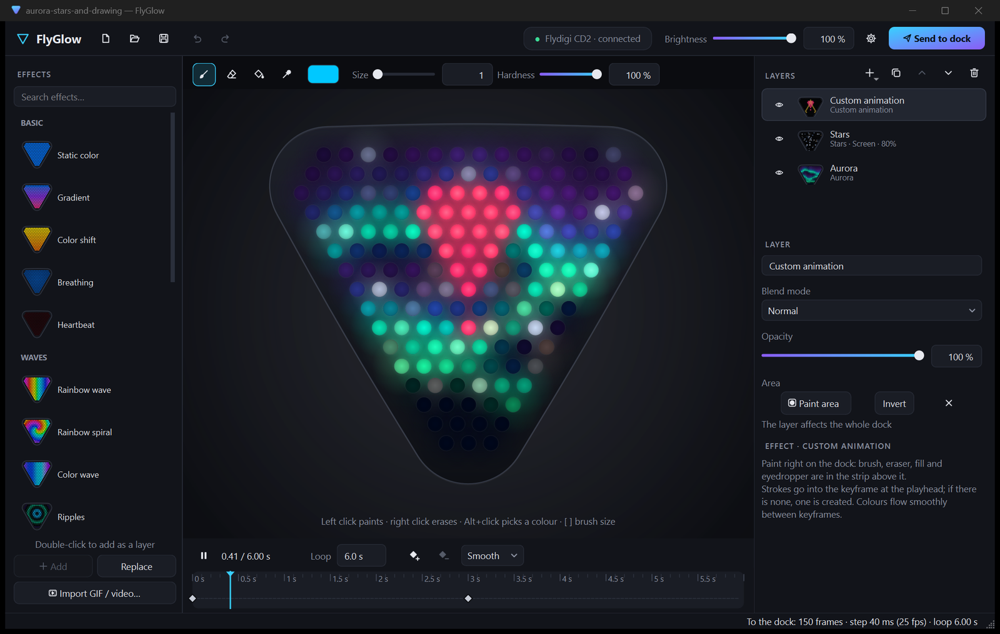
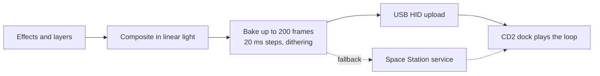

<p align="center">
  
</p>

<h1 align="center">FlyGlow</h1>

<p align="center">
  <b>Smooth, layered lighting for the Flydigi CD2 charging dock.</b><br>
  Effects in layers, LED-by-LED painting, GIF and video, side by side with Space Station.
</p>

<p align="center">
  <a href="LICENSE"></a>
  <a href="#installation"></a>
  <a href="https://github.com/PsinaDev/FlyGlow/releases/latest"></a>
  <a href="https://github.com/PsinaDev/FlyGlow/releases"></a>
  <a href="https://www.qt.io/"></a>
  <a href="#building-from-source"></a>
  <a href="#how-it-works"></a>
  <a href="README.ru.md"></a>
</p>

<p align="center">
  <a href="README.ru.md">Русская версия</a>
</p>

<p align="center">
  
</p>

## Highlights

The CD2 dock has 162 good RGB LEDs, but the effects in Flydigi Space Station look rough: every effect is a fixed
50-frame loop, colours are blended in plain sRGB and fades step through raw 8-bit values. The dock only plays back
the frames it receives, so FlyGlow renders better frames and uploads them.

- **21 smooth effects.** Aurora, fire, plasma, lava lamp, rainbow waves, ripples, visor, comets, stars, rain,
  sparkles, fireflies and more. Linear-light rendering, OKLab blending and up to 200 frames per loop with temporal
  dithering: no banding, no muddy gradient midpoints.
- **Layers like iCUE.** Stack effects with Normal, Add, Screen, Multiply or Lighten blending, set opacity, paint the
  area each layer covers.
- **Your own animation.** Paint the LEDs directly (size 1 is exactly one LED), set keyframes on the timeline and let
  FlyGlow interpolate everything in between, smooth, linear or stepped.
- **GIF and video import.** GIF, APNG, PNG/JPEG and MP4/MOV/M4V/AVI/WMV. Each LED averages its own hex cell of the
  picture; fit, zoom, pan, rotate, trim and colour controls included.
- **Side by side with Space Station.** Uploads go straight to the dock over USB, so Space Station can stay open for
  the controller and the dock settings.
- **Everyday comforts.** Undo and redo, `.flyglow` scene files, session autosave, file association, English and
  Russian UI switchable on the fly.

## How It Works



- **Rendering.** An effect is a pure function of loop phase, so loops are seamless and the preview shows exactly the
  frames that get baked. Layers are composited in linear light; gradients and fades are mixed in OKLab and follow
  perceived brightness.
- **Baking.** The firmware plays uploaded frames and generates nothing itself: up to 200 frames by default
  (255 configurable), a frame interval in 20 ms steps, 8 bits per channel. Temporal error diffusion hides 8-bit
  steps in dark, slow fades.
- **Upload.** FlyGlow opens the dock's vendor HID interface shared with Space Station's service and writes a Custom
  lighting config, about 85 ms per frame. If the HID path is unavailable, it falls back to Space Station's own
  service pipe. An upload rewrites the dock's stored lighting, so it only happens on "Send to dock".
- **Protocols.** [docs/hid-protocol.md](docs/hid-protocol.md) covers the direct USB path,
  [docs/ipc-protocol.md](docs/ipc-protocol.md) covers Space Station's service pipe.

## Installation

Requirements: Windows 10 1809 or later (x64), a Flydigi CD2 dock connected over USB. Space Station is optional.

| Package | Notes |
|---|---|
| `FlyGlow-<version>-setup-win64.exe` | Recommended. English and Russian setup, installs for the current user without admin rights, optional desktop icon and `.flyglow` association. |
| `FlyGlow-<version>-portable-win64.zip` | Unzip anywhere. Settings and autosave stay in `data\` next to the exe. |

Both are on the [Releases](https://github.com/PsinaDev/FlyGlow/releases/latest) page. Picking any effect in
Space Station brings the stock lighting back.

## Building from source

Requirements: Visual Studio 2022 with the C++ tools, Qt 6.10 (msvc2022_64), CMake 3.21+, Inno Setup 7 for the
installer.

From an "x64 Native Tools" prompt:

```bat
cmake -S . -B build -G Ninja -DCMAKE_BUILD_TYPE=RelWithDebInfo -DCMAKE_PREFIX_PATH=C:/Qt/6.10.3/msvc2022_64
cmake --build build
```

Run `build\FlyGlow.exe` with Qt's `bin` folder on `PATH`.

A Visual Studio solution is generated, not written by hand; F5 then starts FlyGlow with Qt on `PATH`:

```bat
cmake -S . -B build-vs -G "Visual Studio 17 2022" -A x64 -DCMAKE_PREFIX_PATH=C:/Qt/6.10.3/msvc2022_64
```

`packaging\build-release.cmd` produces the portable zip and the installer in `dist\`; set `QTDIR` and, if needed,
`ISCC` first. Keep the checkout path short: CMake's try-compile paths hit the Windows 260-character limit under deep
roots.

Developer tools built alongside the app:

- `effects_check <dir>` - checks every effect for NaN, loop seams and harsh steps, and writes PNG previews.
- `media_check <file> <dir>` - decodes a clip and writes a filmstrip of the sampled LEDs.
- `ipc_probe` - read-only queries to Space Station's service; `--selftest` runs offline.
- `FLYGLOW_NO_DEVICE=1` - starts the app without touching the dock.

## License and notices

FlyGlow is released under the [MIT License](LICENSE).

| Component | Notes |
|---|---|
| [Qt 6](https://www.qt.io/) | LGPL-3.0, linked dynamically; the release ships the unmodified Qt DLLs, which can be replaced. |
| Microsoft Visual C++ runtime | Redistributed app-locally under the Visual C++ Redistributable terms. |
| [OKLab](https://bottosson.github.io/posts/oklab/) | Colour space by Björn Ottosson, used for all colour blending. |
| [OpenFlydigi](https://github.com/mkaliaha/openflydigi) | First public documentation of the CD2 HID protocol. |

FlyGlow is an independent project, not affiliated with or endorsed by Flydigi. Flydigi and Space Station are
trademarks of their respective owners. Uploading replaces the dock's stored lighting; use at your own risk.
