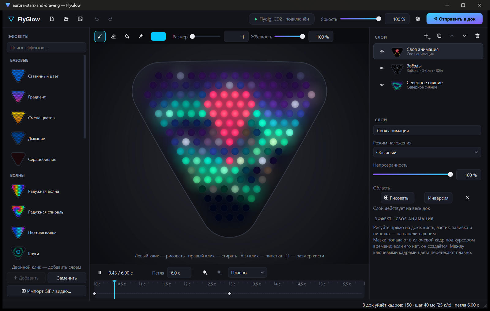
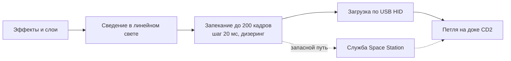

<p align="center">
  
</p>

<h1 align="center">FlyGlow</h1>

<p align="center">
  <b>Плавная многослойная подсветка для док-станции Flydigi CD2.</b><br>
  Слои эффектов, рисование по диодам, GIF и видео, работа рядом с Space Station.
</p>

<p align="center">
  <a href="LICENSE"></a>
  <a href="#установка"></a>
  <a href="https://github.com/PsinaDev/FlyGlow/releases/latest"></a>
  <a href="https://github.com/PsinaDev/FlyGlow/releases"></a>
  <a href="https://www.qt.io/"></a>
  <a href="#сборка-из-исходников"></a>
  <a href="#как-это-работает"></a>
  <a href="README.md"></a>
</p>

<p align="center">
  <a href="README.md">English version</a>
</p>

<p align="center">
  
</p>

## Возможности

У CD2 162 хороших RGB-диода, а эффекты Flydigi Space Station грубые: каждый эффект - петля ровно из 50 кадров,
смешивание цветов в обычном sRGB, затухания ступеньками 8-битных значений. Генерации эффектов в доке нет, только
проигрывание присланных кадров. Задача FlyGlow - считать эти кадры правильно и загружать их в док.

- **21 плавный эффект.** Северное сияние, огонь, плазма, лава-лампа, радужные волны, круги, визор, кометы, звёзды,
  дождь, искры, светлячки и другие. Расчёт в линейном свете, смешивание в OKLab и до 200 кадров на петлю с временным
  дизерингом: без полос и грязных середин градиентов.
- **Слои как в iCUE.** Складывать эффекты в режимах "Обычный", "Сложение", "Экран", "Умножение" и "Замена светлым",
  задавать непрозрачность, рисовать область действия каждого слоя.
- **Своя анимация.** Рисовать прямо по диодам (размер кисти 1 - ровно один диод), ставить ключевые кадры на
  таймлайне, получать промежуточные кадры плавной, линейной или ступенчатой интерполяцией.
- **Импорт GIF и видео.** GIF, APNG, PNG/JPEG и MP4/MOV/M4V/AVI/WMV. Усреднение шестиугольной ячейки кадра под
  каждым диодом, вписывание, масштаб, сдвиг, поворот, обрезка по времени и цветокоррекция.
- **Рядом с Space Station.** Загружать анимацию напрямую в док по USB, не закрывая Space Station: контроллер и
  настройки дока остаются за ней.
- **Удобства.** Отмена и повтор, файлы сцен `.flyglow`, автосохранение сессии, ассоциация файлов, переключение
  интерфейса между английским и русским на лету.

## Как это работает



- **Рендер.** Эффект - чистая функция фазы петли: бесшовные петли, превью ровно из тех кадров, что уйдут в док.
  Сведение слоёв в линейном свете, градиенты и затухания в OKLab по воспринимаемой яркости.
- **Запекание.** В прошивке только проигрывание загруженных кадров: по умолчанию до 200 кадров (настройка до 255),
  шаг кадра кратен 20 мс, 8 бит на канал. Временное распределение ошибки округления против ступенек в тёмных
  медленных затуханиях.
- **Загрузка.** Совместное со службой Space Station открытие вендорского HID-интерфейса дока и запись Custom-конфига
  подсветки, около 85 мс на кадр. Без HID - запасной путь через канал самой службы Space Station. Каждая загрузка -
  перезапись сохранённой подсветки дока, поэтому отправка только по кнопке "Отправить в док".
- **Протоколы.** [docs/hid-protocol.md](docs/hid-protocol.md) - прямой путь по USB,
  [docs/ipc-protocol.md](docs/ipc-protocol.md) - канал службы Space Station.

## Установка

Требования: Windows 10 1809 или новее (x64), док Flydigi CD2 по USB. Space Station не обязательна.

| Пакет | Описание |
|---|---|
| `FlyGlow-<версия>-setup-win64.exe` | Рекомендуемый вариант. Установщик на английском и русском, установка для текущего пользователя без прав администратора, ярлык на рабочем столе и ассоциация `.flyglow` по желанию. |
| `FlyGlow-<версия>-portable-win64.zip` | Распаковать в любую папку. Настройки и автосохранение - в `data\` рядом с exe. |

Оба пакета - на странице [Releases](https://github.com/PsinaDev/FlyGlow/releases/latest). Вернуть стандартную
подсветку: выбрать любой эффект в Space Station.

## Сборка из исходников

Требования: Visual Studio 2022 с инструментами C++, Qt 6.10 (msvc2022_64), CMake 3.21+, для установщика
Inno Setup 7.

Из консоли "x64 Native Tools":

```bat
cmake -S . -B build -G Ninja -DCMAKE_BUILD_TYPE=RelWithDebInfo -DCMAKE_PREFIX_PATH=C:/Qt/6.10.3/msvc2022_64
cmake --build build
```

Запускать `build\FlyGlow.exe` с папкой `bin` из Qt в `PATH`.

Решение Visual Studio не писать руками, а генерировать; F5 в нём - запуск FlyGlow с Qt в `PATH`:

```bat
cmake -S . -B build-vs -G "Visual Studio 17 2022" -A x64 -DCMAKE_PREFIX_PATH=C:/Qt/6.10.3/msvc2022_64
```

`packaging\build-release.cmd` - сборка portable-архива и установщика в `dist\`; перед запуском задать `QTDIR` и при
необходимости `ISCC`. Путь к репозиторию держать коротким из-за ограничения Windows в 260 символов на try-compile
пути CMake.

Инструменты разработчика, собираются вместе с приложением:

- `effects_check <папка>` - проверка всех эффектов (NaN, швы петли, резкие скачки) и PNG-превью.
- `media_check <файл> <папка>` - декодирование ролика и раскадровка того, что попадёт на диоды.
- `ipc_probe` - запросы к службе Space Station только на чтение; `--selftest` без подключения.
- `FLYGLOW_NO_DEVICE=1` - запуск приложения без обращения к доку.

## Лицензия и сторонние компоненты

Лицензия FlyGlow: [MIT](LICENSE).

| Компонент | Примечание |
|---|---|
| [Qt 6](https://www.qt.io/) | LGPL-3.0, динамическая линковка; в релизе немодифицированные DLL Qt с возможностью замены. |
| Среда выполнения Microsoft Visual C++ | Распространение рядом с exe по условиям Visual C++ Redistributable. |
| [OKLab](https://bottosson.github.io/posts/oklab/) | Цветовое пространство Бьёрна Оттоссона, основа всего смешивания цветов. |
| [OpenFlydigi](https://github.com/mkaliaha/openflydigi) | Первое публичное описание HID-протокола CD2. |

FlyGlow - независимый проект, без связи с Flydigi и без её одобрения. Flydigi и Space Station - товарные знаки их
владельцев. Каждая загрузка - замена сохранённой подсветки дока; использование на свой риск.
