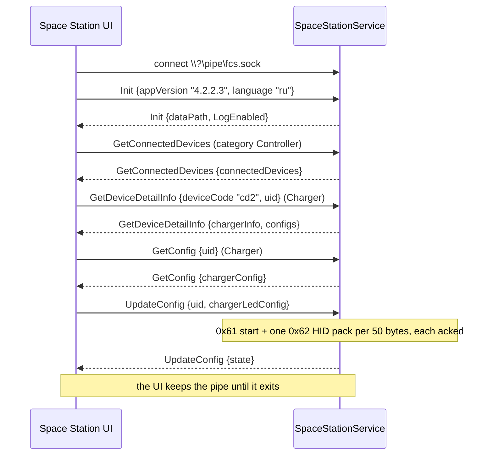
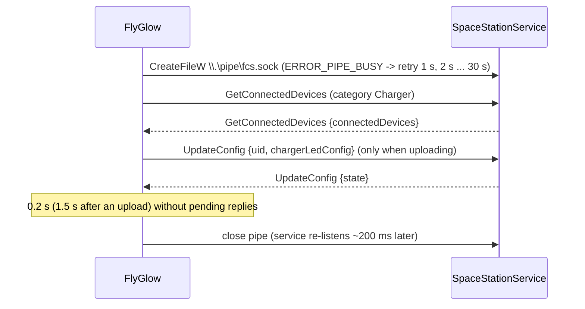

# Space Station IPC protocol (`\\.\pipe\fcs.sock`)

How Flydigi Space Station's Electron UI talks to its background service
(`SpaceStationService.exe`, a .NET Windows service running as LocalSystem), and
what FlyGlow sends over the same channel to upload a Custom animation to the
CD2 dock.

Reverse-engineered from Space Station **4.2.2.3** (`resources\app.asar` ->
`.vite/build/main.js`, socket class + IPC dispatcher; `ChargerDiyPage-*.js`),
the protobuf descriptors embedded in `main.js`, the UTF-16 string table of
`SpaceStationService.exe`, the service logs
(`C:\Program Files\Flydigi Space Station\Logs\service_log_YYYYMMDD.txt`) and
read-only probing of the live service (section 10).

Tools:

* `python -I tools/fdg_ipc.py proto [IpcCommand.proto ...]` prints the full
  `.proto` schema straight from the installed `app.asar` (nothing is copied
  into this repo, so it follows Space Station updates).
* `python -I tools/fdg_ipc.py decode FILE` decodes a file of framed requests
  (`--response` for results) to JSON.
* `python -I tools/fdg_ipc.py probe [--detail]` - live, read-only probe.
* `python -I tools/fdg_ipc.py hold --seconds N` - occupies the pipe without
  sending anything (simulates Space Station's window being open).
* `python -I tools/fdg_fake_service.py --pipe flyglow-fake.sock --update ok|fail|silent|drop|progress`
  - a fake service on a pipe of its own; with `FLYGLOW_FDG_PIPE=flyglow-fake.sock` the client
  (and `ipc_probe --test-upload N`) talks to it instead of `fcs.sock`, so the whole upload path
  can be exercised without the dock.
* `build-ipc\ipc_probe.exe` - the C++ client (`fg::SpaceStationClient`); see
  `tools/ipc_probe.cpp` for `--dry-run-upload`, `--rgb`, `--decode`, `--selftest`, `--watch`,
  `--test-upload` (refused unless `FLYGLOW_FDG_PIPE` names a fake pipe).

---

## 1. Transport

| | |
|---|---|
| Pipe | `\\.\pipe\fcs.sock` (the UI opens it as `\\?\pipe\fcs.sock`; same object) |
| Mode | byte stream, duplex, overlapped I/O fine |
| Server | one `NamedPipeServerStream` at a time, created "with security" so normal users can open it |
| Clients | **exactly one at a time** (see below) |
| Handshake | **none required** |

**One client at a time.** The service runs a loop: create pipe -> `WaitForConnectionAsync`
("Waiting for client connection...") -> read commands ("Waiting for receive command from
client...") -> on disconnect "close server stream", "Client disconnected, waiting for next
connection..." -> ~200 ms later a new pipe instance. While a client is connected, any other
`CreateFile` on the pipe fails with **`ERROR_PIPE_BUSY` (231)**; during the ~200 ms gap after a
disconnect it fails with `ERROR_FILE_NOT_FOUND` (2). Verified live (section 10).

!!! warning "Space Station's window and FlyGlow cannot be connected at the same time"
    While Space Station's UI runs it holds the pipe permanently and FlyGlow cannot reach the
    service at all. That includes the UI hidden in the tray: with the UI's `closeToTray` setting
    (`localStorage`), closing the window only hides it and the connection stays. The reverse is
    worse: if FlyGlow held the pipe, Space Station's UI retries after
    `min(5 s * 1.5^(n-1), 30 s)` and gives up for good after 10 failed attempts (~3.6 min,
    `maxReconnectAttemptsReached`), showing no devices until it is restarted.
    `SpaceStationClient` therefore connects only when it has something to send and releases the
    pipe 0.2 s after the last reply (1.5 s after an upload); the 30 s device poll holds it for
    ~0.2 s.

Further consequences:

* Results always go to whichever client is connected when they are produced
  (`SendResultToIpcCaller`); with no client the service logs `server stream is not connected`
  and drops them.

**No Init needed.** The UI sends `Init` first, but `GetConnectedDevices` works on a fresh
connection without it (section 10). `Init` (`InitParams {appVersion 1, language 2}`) only makes
the service answer `InitResult {dataPath 1, LogEnabled 2, DebugLogEnabled 3}` (the UI uses it to
set up its own log folder); FlyGlow does not send it.

---

## 2. Framing (both directions, same format)

Every message is an ASCII header line terminated by `\n`, then a binary body. All integers are
**int32 little-endian**. Headers (constants `lu`, `ca`, `ua` in `main.js`; the same three
strings appear twice in the service):

### 2.1 Small - `FDG_PROTOCOL`

```text
"FDG_PROTOCOL\n"  int32 len  payload[len]
```

e.g. GetConnectedDevices for chargers:
`46 44 47 5F 50 52 4F 54 4F 43 4F 4C 0A | 05 00 00 00 | 08 81 20 10 06`

### 2.2 Chunked - `FDG_CHUNK`

```text
"FDG_CHUNK\n"  int32 totalLen  int32 chunkCount
    repeated chunkCount times:  int32 chunkLen  chunk[chunkLen]
```

The sender uses 64 KiB (65536-byte) chunks, `chunkCount = ceil(totalLen / 65536)`, the last
chunk shorter. The receiver concatenates the chunks; their lengths must add up to `totalLen`.

### 2.3 Compressed - `FDG_COMPRESSED`

```text
"FDG_COMPRESSED\n"  int32 len  gzipData[len]
```

`gzipData` is **RFC 1952 gzip** (Node `zlib.gzip` / `zlib.gunzip`; the service decompresses
with .NET, "Failed to decompress data"). Not zlib/RFC 1950, so `qUncompress` cannot read it;
FlyGlow has its own inflate (`src/device/FdgFraming.cpp`) and, for sending, writes valid gzip
made of stored (uncompressed) deflate blocks.

### 2.4 Which framing

The UI's sender picks by protobuf size: **< 1 MiB small, 1 MiB..5 MiB chunked, >= 5 MiB
compressed** (`ia = 1024*1024`, `oa = 5*1024*1024`). Receivers (UI and service) accept any
framing for any size. A FlyGlow upload is at most ~1.8 KB per frame (255 frames ~ 460 KB), so
uploads always go out as small messages. Results the service sends back are normally small.

### 2.5 Receiver rules (as implemented by the UI)

* Header = bytes up to the first `\n`, trimmed; must start with `FDG_`, otherwise skip to the
  next `FDG_` in the buffer (resync).
* Type: starts with `FDG_COMPRESSED` -> compressed, `FDG_CHUNK` -> chunked, any other `FDG_`
  header -> small.
* Small: length must be 1..100 MiB, else resync. Zero-length messages are not used (the service
  logs "Empty payload after serialization, skip send" and sends nothing).
* Several messages may arrive in one read and one message may span reads.
* The service rejects over-long header lines ("header too long").

---

## 3. Messages

Package `Flydigi.SharedResources.data.protobuf`, proto3. Requests are `IpcCommand`, responses
and events are `IpcResult` (file `IpcCommand.proto`, message indexes 0 and 6;
`xn = I(v,0)`, `oc = I(v,6)` in `main.js`). Field numbers below are what goes on the wire.

### 3.1 Request: `IpcCommand`

| # | field | type |
|---|---|---|
| 1 | `cmdId` | `IpcCommandEnum` |
| 2 | `category` | `optional Category` (explicit presence; the UI always sets it, default `Category_Controller`) |
| 3..86 | `oneof params` | one parameter message, see below |

Members of `params` relevant here:

| # | member | type |
|---|---|---|
| 3 | `getConnectedDeviceParam` | `GetConnectedDevicesParams {}` (the UI never sets it) |
| 4 | `getDeviceDetailInfoParam` | `GetDeviceDetailInfoParams {string deviceCode = 1; string uid = 2}` |
| 5 | `getConfigParam` | `GetConfigParams {deviceCode 1, uid 2, cfgId 3, repeated ConfigType configType 4, optional keyId 5}` |
| 6 | `updateConfigParam` | `UpdateConfigParams` (3.3) |
| 55 | `initParam` | `InitParams {string appVersion = 1; string language = 2}` |

There is **no request id**: replies are matched by `cmdId` only (and the service handles
commands strictly one after another through a queue).

### 3.2 Response / event: `IpcResult`

| # | field | type |
|---|---|---|
| 1 | `cmdId` | `IpcCommandEnum` - the command this answers, or the event type |
| 2 | `state` | `bool` - success flag (`updateConfigResult` in the UI is exactly this) |
| 3 | `code` | `int32` - error code (0 in everything observed) |
| 4 | `category` | `Category` |
| 5.. | `oneof data` | payload, see below |

| # | `data` member | type |
|---|---|---|
| 5 | `getConnectedDevices` | `GetConnectedDevicesResult {repeated DeviceInfo connectedDevices = 1}` |
| 6 | `deviceConnectionChanged` | `DeviceConnectionChangedResult {DeviceInfo deviceInfo = 1}` |
| 7 | `getDeviceDetailInfo` | `GetDeviceDetailInfoResult` (3.5) |
| 9 | `getConfigResult` | `GetConfigResult` (charger: `optional ChargerMappingConfigBean chargerConfig = 12`) |
| 54 | `initResult` | `InitResult {dataPath 1, LogEnabled 2, DebugLogEnabled 3}` |
| 56 | `ProgressChangedResult` | `ProgressChangedResult {double progress = 1}` (percent, 100 = done) |
| 65536 | `deviceNotSupportedResult` | `HidDevice` |

Unsolicited results the service pushes to the connected client: `DeviceConnectionChanged`
(4098) on plug/unplug, `GetDeviceDetailInfo` (4099) whenever a device's state changes (for the
dock: controller docked/undocked, battery; seen every few minutes in pairs 1 s apart),
`RollingRateReport`, `CoolerDataReport`, `UploadProgressChanged` etc. A client must accept
and ignore results it did not ask for.

### 3.3 `UpdateConfigParams` (the charger path)

| # | field | type | DIY page |
|---|---|---|---|
| 1 | `deviceCode` | string | not set |
| 2 | `uid` | string | dock uid |
| 3 | `cfgId` | int32 | 0 (= not on the wire) |
| 4..9, 11 | controller configs, `title` | | not set |
| 12 | `chargerLedConfig` | `optional ChargerLedConfig` | **our animation** |
| 13..16 | `sleepWhenCharging`, `showAnimationWhenCharging`, `ledSync`, `closeWithSystem` | `optional bool` | not set (separate Enable* commands are used for these) |
| 17 | `chargerLedTypeAdvanced` | `optional ChargerLedTypeAdvanced {ChargerAdvancedLedType mode = 1}` | not set |

`ChargerLedConfig` (ChargerMappingConfigBean.proto):

| # | field | type |
|---|---|---|
| 1 | `mode` | `ChargerLedType` |
| 2 | `period` | int32 - frame interval, units of 20 ms (see 5.2) |
| 3 | `brightness` | int32, 1..100 |
| 4 | `color` | `repeated Color` - palette for the built-in effects |
| 5 | `useColorCount` | int32 |
| 6 | `direction` | `ChargerLedDirection` |
| 7 | `frames` | `repeated FramedLedColor` |

`FramedLedColor {int32 brightness = 1; repeated Color colors = 2}`,
`Color {int32 red = 1; int32 green = 2; int32 blue = 3}` (Common.proto).

### 3.4 `DeviceInfo` (Device.proto)

| # | field | CD2 dock (live) |
|---|---|---|
| 1 | `productName` | `"Flydigi CD2"` |
| 2 | `category` | `Category_Charger` (6) |
| 3 | `connectType` | `ConnectType_Wired` (1) |
| 4 | `deviceCode` | `"cd2"` |
| 5 | `deviceType` | 0 (`ChargerDeviceType_CD2`; 1..4 = EVA, SRS, GS, MHY_HK editions) |
| 6 | `deviceMac` | - |
| 7 | `uid` | `"1960f0f1f2cdabb2173bbdba80"` |
| 8 | `isConnected` | true |
| 9 | `battery` | - |
| 10 | `firmwareVersion` | `"0.0.3.9"` |
| 11 | `vendorId` | 14295 (0x37D7) |
| 12 | `productId` | 24577 (0x6001) |
| 13 | `firmwares` | `repeated FirmwareInfo {ChipModule chipModule 1, ChipType chipType 2, optional string version 3}` -> `[{chipType Wch, version "0.0.3.9"}]` |
| 14 | `isNewArchitecture` | false |

There is no nickname field; `productName` is the display name.

### 3.5 `GetDeviceDetailInfoResult`

`oneof deviceInfo {ControllerInfo 1, KeyboardInfo 2, MouseInfo 3, CoolerInfo 4, HeadsetInfo 5,
ChargerInfo 7}`, `ConfigsResult configs = 6`, `bool onlyRefresh = 8`,
`optional string thirdPartyAppControlledTag = 9`, `bool thirdPartyAppControlUsable = 10`.

`ChargerInfo {DeviceInfo parent 1, bool sleepWhenCharging 2, bool ledSync 3,
bool closeWithSystem 4, bool showAnimationWhenCharging 5, bool isControllerConnected 6,
int32 controllerBattery 7}`. Not needed for uploads; FlyGlow does not send it.

---

## 4. Enums

`IpcCommandEnum` (selection; full list: `fdg_ipc.py proto IpcCommand.proto`):

| value | name | |
|---|---|---|
| 0 | `IpcCommandEnum_Unknown` | |
| 1 | `IpcCommandEnum_Init` | optional handshake, see 1 |
| 4097 | `IpcCommandEnum_GetConnectedDevices` | read-only |
| 4098 | `IpcCommandEnum_DeviceConnectionChanged` | event |
| 4099 | `IpcCommandEnum_GetDeviceDetailInfo` | read-only (reads the dock's onboard config header) |
| 4100 | `IpcCommandEnum_GetCurrentAppliedConfigId` | |
| 4112 | `IpcCommandEnum_GetConfig` | read-only |
| 4113 | `IpcCommandEnum_UpdateConfig` | **writes to the device** |
| 4114 | `IpcCommandEnum_SaveConfig` | writes |
| 4147 / 4148 | `UploadPic` / `UploadProgressChanged` | |
| 24577 | `IpcCommandEnum_UpdateFrame` | `UpdateFrameParams {uid 1, cfgId 2, FramedLedColor frame 3}` (live single frame; the 4.2.2.3 UI never sends it) |
| 24578..24581 | `EnableCloseWithSystem`, `EnableSleepWhenCharging`, `EnableShowAnimationWhenCharging`, `EnableLedSync` | dock settings (writes) |
| 28677 | `IpcCommandEnum_SetRgbConfig` | cooler |
| 57345 | `IpcCommandEnum_EnableLog` | |
| 65536 | `IpcCommandEnum_DeviceNotSupported` | event |

`Category`: Unknown 0, Controller 1, Cooler 2, Keyboard 3, Mouse 4, Headset 5, **Charger 6**.

`ChargerLedType`: Close 0, Solid 1, Default 2, **Custom 3**, Diagonal_Flow 4, Breath 5,
Gradient 6, Wave_Gradient 7, Rainbow 8, Pulse 9.

`ChargerLedDirection`: NONE 0, ToRight 1, ToLeft 2, ToDown 3, ToUp 4, ToRightDown 5,
ToRightUp 6, ToLeftDown 7, ToLeftUp 8.

`ConnectType`: Unknown 0, Wired 1, Dongle 2, Bluetooth 3.

Enum value names are what the service log prints (`"IpcCommandEnum_UpdateConfig"`,
`"Category_Charger"`, `"ChargerLedType_Custom"`).

---

## 5. Uploading a Custom animation (what the DIY page does)

### 5.1 The message

`ChargerDiyPage` builds (`kt()`):

```js
{cmdId: UpdateConfig, category: device.category /* Charger */, uid, cfgId: 0,
 chargerLedConfig: {mode: Custom, period, direction: NONE, brightness: 100,
                    useColorCount: 0, color: [], frames}}
// frames[i] = {brightness: 100, colors: 162 x {red, green, blue}}
```

and `main.js` (`fu()`) turns it into `IpcCommand{cmdId 4113, category 6,
updateConfigParam{deviceCode: undefined, uid, cfgId 0, chargerLedConfig}}`. On the wire
(proto3 implicit presence: zero/empty scalars are omitted; every repeated element is written,
so a black LED is an empty `Color`, bytes `12 00`):

```text
IpcCommand
  1  cmdId              = 4113 (UpdateConfig)
  2  category           = 6    (Charger)
  6  updateConfigParam {
       2  uid               = "1960f0f1f2cdabb2173bbdba80"
       12 chargerLedConfig {
            1 mode       = 3 (Custom)
            2 period     = 1..255
            3 brightness = 100 (DIY page) / 1..100 (FlyGlow passes its own)
            7 frames[]   { 1 brightness = 100
                           2 colors[] (162 per frame, LED order = row-major, top row first)
                               { 1 red, 2 green, 3 blue } }  } }
```

The service logs it as (truncated):
`Receive command from client: { "cmdId": "IpcCommandEnum_UpdateConfig", "category": "Category_Charger", "updateConfigParam": { "uid": "1960f0f1f2cdabb2173bbdba80", "chargerLedConfig": { "mode": "ChargerLedType_Custom", "period": 4, "brightness": 100, "frames": [ { "brightness": 100, "colors": [ { "red": 235, "green": 124, "blue": 71 }, ...`

FlyGlow builds exactly this in `fg::fdg::buildUpdateConfigCustom` (`src/device/FdgMessages.cpp`).
`ipc_probe --dry-run-upload` output decoded by `fdg_ipc.py decode` has the identical JSON key
structure as the logged DIY uploads (section 10).

Size: ~8.8 bytes per LED -> ~1.4-1.8 KB per frame; 200 frames ~ 300-360 KB (small framing).

### 5.2 Parameters

* **period**: the dock steps one frame every `period x 20 ms` (hardware-measured; see
  `ref/openflydigi/docs/findings-other-devices.md`). The DIY page computes
  `period = round(interval_ms / 10)`, i.e. it uses the wrong unit and its uploads play at half
  speed. FlyGlow passes period in 20 ms units directly. Range 1..255 (one byte on the dock).
* **brightness**: `chargerLedConfig.brightness` 1..100. The DIY page always sends 100; the
  built-in effects send their slider value (e.g. 50) in both `brightness` and every frame's
  `brightness`. The service's dock blob has a single brightness byte (header:
  frameCount, period, brightness, mode, direction, useColorCount, palette, frames), so the
  per-frame value is presumably unused; FlyGlow keeps the DIY page's 100 there.
* **frames**: 1..255 (one byte on the dock), 200 known safe. 162 colours per frame.

### 5.3 What the service does with it

`UpdateConfig` -> `ChargerCommunicationThread` -> `WriteLedConfigCommandStartNewXInput`
(HID cmd 0x61) -> `WriteLedConfigPackCommandNewXInput` (0x62) for every 50-byte pack of the
blob (`6 + 3*useColorCount + 486*frames` bytes for Custom: 6 + 486*N), each pack waiting for its
ack (~8.7 ms per pack) -> result. Measured from the logs:

| frames | packs | send -> result |
|---|---|---|
| 1 | 10 | 0.09 s |
| 15 | 146 | 1.28 s |
| 36 | 351 | 3.07 s |
| 50 (built-in effects) | 487 | 4.25 s |

=> ~85 ms per frame; 200 frames ~ 17 s.

**Pack-count quirk:** Space Station announces `len // 50 + 1` packs but sends `ceil(len / 50)`.
They differ when the blob length is a multiple of 50, which for Custom happens when
`frames % 25 == 4` (4, 29, 54, 79, 104, 129, 154, 179, 204, 229, 254 frames): the dock is promised
one pack more than it gets. What the dock does then is untested; FlyGlow logs a warning for such
frame counts. Avoiding them (e.g. padding by one frame) is the safe choice.

---

## 6. Outcome of UpdateConfig

* The service answers **one `IpcResult {cmdId: 4113 UpdateConfig, state, code}`** after the
  last pack was acknowledged by the dock (log: `add UpdateConfig to result queue successfully`).
  `state` is the success flag. There is no other payload.
* **No progress events** for the charger. `UploadProgressChanged` (4148,
  `ProgressChangedResult.progress` in percent) appears only for controller mapping writes and
  picture uploads. (`SpaceStationClient` forwards it to `uploadProgress` if it ever comes.)
* Charger UpdateConfig is not followed by an automatic `SaveConfig` (controllers get one).
* The UI's handling is minimal: `updateConfigResult` just closes the "saving" dialog
  (60 s timeout on the dialog).
* If the client disconnects before the result, the upload still completes on the service side
  and the result is dropped (or delivered to the next client that connects).

FlyGlow: `uploadFinished(id, state, ...)` on that result; failure if no result within
`15 s + 150 ms x frames`, if the pipe closes first, or if the pipe cannot be obtained within 20 s.
Uploads go out one at a time (the result carries no request id); after a timeout or a lost
connection the next late `UpdateConfig` result within 2 min is swallowed instead of being
credited to the following upload.

---

## 7. GetConnectedDevices - finding the dock

Request: `IpcCommand {cmdId 4097, category 6}` (no params; the UI sends category 1, the
category does not filter the answer). Payload bytes `08 81 20 10 06`.

Response: `IpcResult {cmdId 4097, state true, getConnectedDevices(5) {connectedDevices[] DeviceInfo}}`,
every connected Flydigi device of every category.

The CD2 dock is the entry with `category == Category_Charger (6)` and `deviceCode == "cd2"`
(also `vendorId 0x37D7`, `productId 0x6001`, `productName "Flydigi CD2"`); use `uid` for
UpdateConfig, `productName` as the name, `firmwareVersion` as firmware. FlyGlow additionally
requires `isConnected`.

---

## 8. Sessions

Space Station's UI (from the service log), for reference:



FlyGlow's session:



---

## 9. FlyGlow implementation map

| file | |
|---|---|
| `src/device/ProtoWire.h` | protobuf varint / length-delimited writer and reader |
| `src/device/FdgFraming.h/.cpp` | the three framings, stream decoder with resync, gzip inflate, stored-gzip writer, CRC-32 |
| `src/device/FdgMessages.h/.cpp` | field numbers, enums, `buildUpdateConfigCustom`, `buildGetConnectedDevices`, result parsers |
| `src/device/SpaceStationClient.h/.cpp` | `QLocalSocket` client: on-demand connect (own `CreateFileW` so a busy pipe never blocks the GUI thread), backoff 1 s -> 30 s, idle release, 30 s device poll, one upload in flight, result matching |
| `tools/ipc_probe.cpp` | CLI around the client |
| `tools/fdg_ipc.py` | schema dump, decoder, read-only probe, pipe holder |
| `tools/fdg_fake_service.py` | fake service for upload tests (`FLYGLOW_FDG_PIPE`) |

---

## 10. Evidence (live probing, 2026-10-15, read-only)

Space Station's UI was not running (service only). Only `GetConnectedDevices` and
`GetDeviceDetailInfo` were ever sent; nothing was written to the dock.

`python -I tools/fdg_ipc.py probe --detail`:

```text
client A connected to \\.\pipe\fcs.sock
client B (concurrent) refused: winerror 231 = ERROR_PIPE_BUSY -> single client at a time
-> {"cmdId": "IpcCommandEnum_GetConnectedDevices", "category": "Category_Charger"} (5 B payload)
<- [small, 90 B] {"cmdId": "IpcCommandEnum_GetConnectedDevices", "state": true, "getConnectedDevices":
   {"connectedDevices": [{"productName": "Flydigi CD2", "category": "Category_Charger",
   "connectType": "ConnectType_Wired", "deviceCode": "cd2", "uid": "1960f0f1f2cdabb2173bbdba80",
   "isConnected": true, "firmwareVersion": "0.0.3.9", "vendorId": 14295, "productId": 24577,
   "firmwares": [{"chipType": "Wch", "version": "0.0.3.9"}]}]}}
-> {"cmdId": "IpcCommandEnum_GetDeviceDetailInfo", "category": "Category_Charger",
    "getDeviceDetailInfoParam": {"deviceCode": "cd2", "uid": "1960f0f1f2cdabb2173bbdba80"}}
<- [small, 148 B] {"cmdId": "IpcCommandEnum_GetDeviceDetailInfo", "state": true, "category": "Category_Charger",
   "getDeviceDetailInfo": {"configs": {...}, "chargerInfo": {"parent": {...}, "ledSync": true,
   "isControllerConnected": true, "controllerBattery": 6}}}
client A closed; 2 messages received
reconnect check: pipe available again after ~400 ms
```

No `Init` was sent: the service answers without a handshake.

`build-ipc\ipc_probe.exe`:

```text
[client] connected to \\.\pipe\fcs.sock
[client] -> GetConnectedDevices
[client] <- GetConnectedDevices: 1 device(s), 1 CD2 dock(s)
service reachable: yes
docks: 1
  uid=1960f0f1f2cdabb2173bbdba80  name="Flydigi CD2"  firmware=0.0.3.9
```

Same, while `fdg_ipc.py hold --seconds 6` occupied the pipe: first attempt
`cannot connect: pipe busy ...`, retried with backoff, connected and listed the dock once the
holder left. `ipc_probe --watch 42` with the pipe held from 27 s to 35 s: idle release after
the first query, the 30 s poll got `ERROR_PIPE_BUSY` -> `connectedChanged(false)` and an empty
dock list, the backoff retry at 37 s reconnected -> `connectedChanged(true)`, dock back.

Dry run (`ipc_probe --dry-run-upload f.bin`, 3 frames, period 5): `FDG_PROTOCOL`, 4278-byte
protobuf, decoded by `fdg_ipc.py decode` to
`{"cmdId": "IpcCommandEnum_UpdateConfig", "category": "Category_Charger", "updateConfigParam":
{"uid": ..., "chargerLedConfig": {"mode": "ChargerLedType_Custom", "period": 5, "brightness": 100,
"frames": [{"brightness": 100, "colors": [{"red": 153, "green": 84, "blue": 54}, ...162]} x3]}}}`,
key structure identical to the logged DIY uploads.

**Byte-identical to the DIY page:** the three Custom uploads in `service_log_20261014.txt`
(1 frame period 1, 15 frames period 4, 36 frames period 4) were re-encoded from their logged
JSON in field-number order (what protobuf-es does) and compared with
`ipc_probe --dry-run-upload --rgb <their colours> --period <p>`: 1732, 21336 and 48235 bytes,
identical in all three cases.

Upload path against `tools/fdg_fake_service.py` (`ipc_probe --test-upload`): success
(`uploadFinished(1, true)` after the fake's 85 ms/frame delay), `state=false code 7` ->
`uploadFinished(false, "... failure (code 7)")`, no answer -> timeout after 15 s, pipe dropped ->
"connection ... lost", progress events -> `uploadProgress(0.5)`, `(1.0)`, three uploads queued at
once -> #1 sent, #2 superseded by #3, #3 sent after #1's result; compressed and chunked replies
and unsolicited `GetDeviceDetailInfo` / `DeviceConnectionChanged` pushes handled.

Framing decoder: a stream with small, gzip (levels 9/6/1, up to 5.5 MB), chunked (1.8 MB) and
garbage between messages, produced by Python's `gzip`, decodes correctly in C++
(`ipc_probe --decode`); `ipc_probe --selftest` covers round trips and CRC checks.
